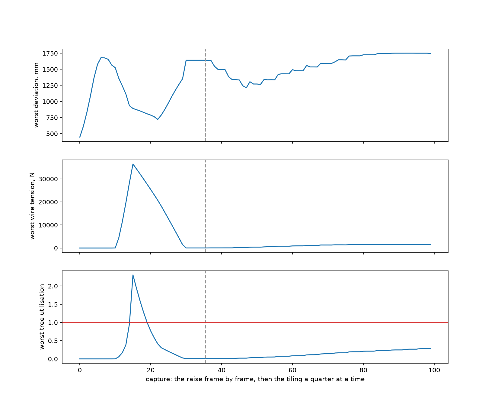
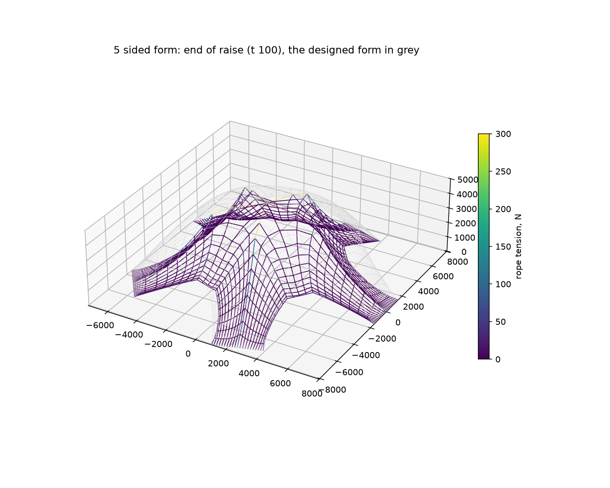
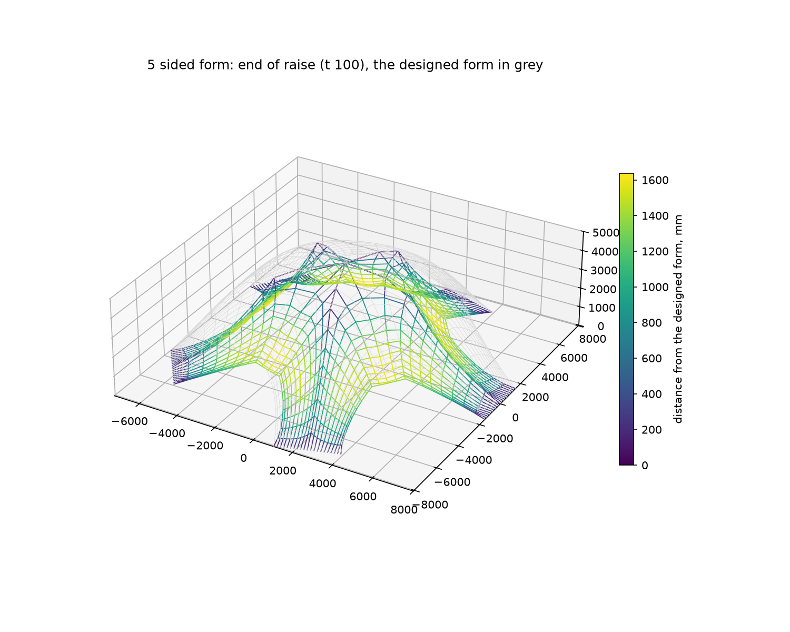
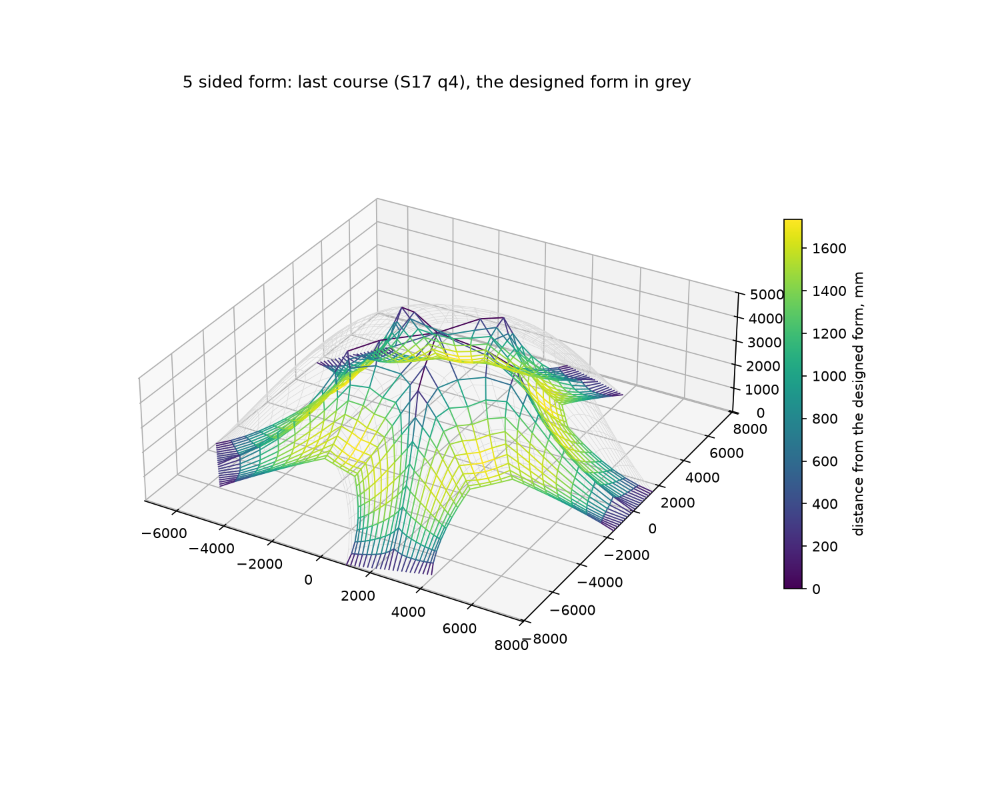

# The formwork engine on the real study: what the run says

This is the formwork engine, part 1 of the Formwork tab, run on the owner's study `5 sided form` through the studio's own formwork route and in process, by `bench/scripts/formwork_real.py`, on 9 October 2026: once at one wire a motor and once at two. Each block below is copied as it was printed. Most come from the script itself; the rest come from short readings of the same runs' capture documents and of the study's own documents, for figures the script does not print, and each block says which file it is from. All of them are kept beside the study in `bench/studies/5-sided-form/results/`, and none is committed. The prose between the blocks only says how to read them; the last section says what follows for the other four parts.

To run it again, from the repository root: `.venv/Scripts/python.exe bench/scripts/formwork_real.py`, and for the second run add `--wires-per-motor 2 --images <a folder of your own>`. It reads the export folder that the studio's settings name and writes only under `bench/studies/` and the images folder.

## 1. What was run

The script asked the route for tile in the bonded-courses pattern, pieces of 1.0 m, a skin 0.02 m thick, the 4 mm rope at a prestress of 300 N, one wire a motor and a tube wall of 3.2 mm. As in the cable net run, the pattern only names the file: this study's cut is its authored skin, and the captures are filed as `bench/studies/5-sided-form/studio/formwork-sim-tile-authored-s1000-t20.json`.

The run took 110 s, and the engine's own clock 101.5 s for its 100 captures: 36 frames of the raise and the hold, every two units of machine time from 30 to 100, then 64 quarters of the tiling. Every capture closed. Newton brought each one to rest, none needed relaxation, and the largest force left over at any node in any capture was 0.0099 N, inside the 0.01 N the engine accepts; a capture that did not close would have failed the run with its reason. From `formwork-real-1.txt`:

```
run done after 110 s 
100 captures in 101.5 s; the thinnest standard wall that holds every capture: none of them
worst deviation from the designed form: 1640 mm at the end of the raise, 1746 mm under the last course
worst wire tension 36459 N; most a rim node is let out 2.66 mm; worst tree utilisation 2.30; 0 captures needed relaxation
```

and from `formwork-real-figures-1.txt`:

```
relaxation captures 0 | largest leftover force over every capture 0.009942 N
```

The whole sequence, capture by capture: the worst deviation, the worst wire and the worst tree, with the end of the raise dashed and the trees' full use in red.



## 2. The net laid out

The animation's frame at machine time 30, where the raise begins, is not a layout a net can take. Against the lengths the net was cut to, its members run from 44 per cent short to 130 per cent stretched, and its 950 inner nodes hover up to 421 mm above the ground. From `formwork-real-figures-1.txt`:

```
== the frame at machine time 30 as drawn, against the cut: 950 inner nodes up to 421 mm above the ground; members from 44 per cent short to 130 per cent stretched
```

So the engine lays the net out as people would. The rim nodes sit on their anchors and the heads' nodes in their notches; every other node goes on the ground under where the frame draws it; the net slides on the ground without friction until nothing is stretched, and friction then holds it. Laid out, no rope pulls as much as a thousandth of a newton, and the worst node is 445 mm from where the frame draws it, which is the first capture's deviation. From `formwork-real-figures-1.txt` and then `formwork-real-1.txt`:

```
machine time 30, laid out: largest rope force 0.0009332 N, members over 0.01 N: 0
```

```
phase    where        dev mm    wire N    out mm     head N   tree  solver
raise    t 30            445         0      0.00          6   0.00  newton 0
```

## 3. The raise

The trees lift the net off the ground over the first half of the raise. Counting the nodes lower than 1 mm, all 1101 are on the ground at machine time 30, 545 at 42 and 225 at 50, and from 54 on only the 105 rim nodes on their anchors: the net leaves the ground between machine time 50 and 54. From `formwork-real-figures-extra.txt`:

```
== the net on the ground (z under 1 mm) through the raise, of 1101 nodes, 105 on wires
t 30: 1101
t 32: 1005
t 34: 875
t 36: 835
t 38: 795
t 40: 680
t 42: 545
t 44: 405
t 46: 320
t 48: 315
t 50: 225
t 52: 135
t 54: 105
t 56: 105
t 58: 105
t 60: 105
t 54: the 105 nodes on the ground are the rim nodes: True
t 60: the 105 nodes on the ground are the rim nodes: True
```

All 46 heads carry the net until machine time 46, 26 at 48, and 21 from 50 to the end of the finish phase. The worst node is 1682 mm from where the frame draws it at 42, with the net half lifted, and the wires begin to pull at 48. From `formwork-real-1.txt`, the raise, the finish phase and the hold:

```
phase    where        dev mm    wire N    out mm     head N   tree  solver
raise    t 30            445         0      0.00          6   0.00  newton 0
raise    t 32            613         0      0.00          6   0.00  newton 56
raise    t 34            831         0      0.00         14   0.00  newton 31
raise    t 36           1085         0      0.00         14   0.00  newton 138
raise    t 38           1365         0      0.00         13   0.00  newton 60
raise    t 40           1577         0      0.00         16   0.00  newton 114
raise    t 42           1682         0      0.00         14   0.00  newton 79
raise    t 44           1677         0      0.00         18   0.00  newton 66
raise    t 46           1655         0      0.00         17   0.00  newton 392
raise    t 48           1567         2      0.00         40   0.00  newton 169
raise    t 50           1525        25      0.00        112   0.00  newton 307
raise    t 52           1360      4415      0.00       8269   0.06  newton 59
raise    t 54           1242     11435      0.00      13380   0.17  newton 8
raise    t 56           1116     19612      0.00      26075   0.38  newton 9
raise    t 58            934     28346      0.00      57524   0.96  newton 5
finish   t 60            891     36459      0.00     113094   2.30  newton 4
finish   t 62            872     34336      0.00      96117   1.94  newton 9
finish   t 64            853     32173      0.00      80017   1.59  newton 6
finish   t 66            831     29945      0.00      64840   1.28  newton 6
finish   t 68            808     27695      0.00      51011   1.00  newton 9
finish   t 70            788     25417      0.00      38899   0.77  newton 6
finish   t 72            763     23092      0.00      28423   0.58  newton 8
finish   t 74            721     20720      0.00      18721   0.41  newton 8
finish   t 76            790     18193      0.00      14618   0.31  newton 14
finish   t 78            878     15472      0.00      12536   0.26  newton 9
finish   t 80            977     12722      0.00      10482   0.21  newton 9
finish   t 82           1082      9946      0.00       8439   0.16  newton 12
finish   t 84           1178      7146      0.00       6401   0.12  newton 15
finish   t 86           1268      4324      0.00       4367   0.07  newton 16
finish   t 88           1352      1484      0.00       2336   0.03  newton 11
hold     t 90           1640        30      0.00        231   0.01  newton 103
hold     t 92           1640        30      0.00        231   0.01  newton 0
hold     t 94           1640        30      0.00        231   0.01  newton 0
hold     t 96           1640        30      0.00        231   0.01  newton 0
hold     t 98           1640        30      0.00        231   0.01  newton 0
hold     t 100          1640        30      0.00        231   0.01  newton 0
```

and from `formwork-real-figures-1.txt`, the heaviest rope and the heads still touching, around the peak and at the start of the hold:

```
capture    rope max N  heads touching  wire max N  trees
t 44               39              46           0   0.00
t 46               24              46           0   0.00
t 48               26              26           2   0.00
t 50               97              21          25   0.00
t 52             8413              21        4415   0.06
t 54            20419              21       11435   0.17
t 56            33108              21       19612   0.38
t 58            50100              21       28346   0.96
t 60            74245              21       36459   2.30
t 62            67365              21       34336   1.94
t 86             6017              21        4324   0.07
t 88             2325              21        1484   0.03
t 90              300              11          30   0.01
t 92              300              11          30   0.01
```

The finish phase's peak is its first frame, machine time 60. A rope pulls 74,245 N and a wire 36,459 N, and the trees are used 2.30 times over with a 3.2 mm wall. The reason is in the frames. They lift the heads to their full height by machine time 60 while 45 of the 46 are still up to 994 mm inside their final places, and only then slide them out, level, to those places by machine time 90. From `formwork-real-figures-1.txt`:

```
t 58: heads up to 333 mm below their final height and up to 994 mm inside their final places (45 of 46 still to slide)
t 60: heads up to 0 mm below their final height and up to 994 mm inside their final places (45 of 46 still to slide)
t 62: heads up to 0 mm below their final height and up to 928 mm inside their final places (45 of 46 still to slide)
```

A head at its full height but up to a metre inside its place holds the net further from the rim than the net was cut to reach, so the net stretches; as the heads slide out it eases, and every figure falls with the distance left to go. At machine time 62, with the heads up to 928 mm in, the rope is at 67,365 N and the trees at 1.94; at 88 the rope is at 2,325 N and the wire at 1,484 N; at the hold the rope is back at the prestress of 300 N and the wire at 30 N. The studio's parts catalogue (`bench/studio/parts.json`) gives the 4 mm rope a minimum breaking load of 9,091 N, and the heaviest rope is over it from machine time 54 to 84.

## 4. The hold and the tiling

At the hold, machine time 90 to 100, the net rests on its rim and on the 11 highest heads: they stand 4432 to 5000 mm high, and the 35 the net has left stand 724 to 4007 mm, their nodes 272 to 605 mm to one side of them and 306 to 665 mm below. The worst node is 1640 mm from the designed form; no wire pulls more than 30 N, no rope more than the prestress of 300 N, and the trees are at 0.01. From `formwork-real-figures-extra.txt` and then `formwork-real-figures-1.txt`:

```
== at the hold: the 11 heads touching stand 4432 to 5000 mm high, the 35 not touching 724 to 4007 mm
```

```
t 48: the 20 heads not touching have their nodes 189 to 317 mm to one side and 278 to 451 mm below
t 50: the 25 heads not touching have their nodes 120 to 235 mm to one side and 169 to 306 mm below
t 60: the 25 heads not touching have their nodes 43 to 111 mm to one side and 86 to 167 mm below
t 90: the 35 heads not touching have their nodes 272 to 605 mm to one side and 306 to 665 mm below
t 100: the 35 heads not touching have their nodes 272 to 605 mm to one side and 306 to 665 mm below
S17 q4: the 35 heads not touching have their nodes 310 to 725 mm to one side and 364 to 802 mm below
```





The tiling puts the skin on a row at a time from the bottom, each row in four quarters in the order the animation drops its pieces, with the reels held where they stopped at the hold. It runs over 16 rows, S1 to S15 and S17. The cut's plan has 20 stages, but the pieces of S16, S18, S19 and S20 cover none of the net's 1000 faces, so they add no weight and give no captures; every face is on by the end of S17. From `formwork-real-figures-extra.txt`:

```
== the cut: 1000 net faces, 1000 assigned to a piece; 756 pieces, 545 of them with faces
stage  1:  30 new pieces covering 100 new faces; the plan's faces so far 100
stage  2:  35 new pieces covering  30 new faces; the plan's faces so far 130
stage  3:  30 new pieces covering  90 new faces; the plan's faces so far 220
stage  4:  35 new pieces covering  70 new faces; the plan's faces so far 290
stage  5:  40 new pieces covering  80 new faces; the plan's faces so far 370
stage  6:  45 new pieces covering  90 new faces; the plan's faces so far 460
stage  7:  50 new pieces covering  70 new faces; the plan's faces so far 530
stage  8:  55 new pieces covering 100 new faces; the plan's faces so far 630
stage  9:  60 new pieces covering  90 new faces; the plan's faces so far 720
stage 10:  70 new pieces covering 100 new faces; the plan's faces so far 820
stage 11:  61 new pieces covering  70 new faces; the plan's faces so far 890
stage 12:  54 new pieces covering  30 new faces; the plan's faces so far 920
stage 13:  48 new pieces covering  30 new faces; the plan's faces so far 950
stage 14:  41 new pieces covering  20 new faces; the plan's faces so far 970
stage 15:  35 new pieces covering  20 new faces; the plan's faces so far 990
stage 16:  24 new pieces covering   0 new faces; the plan's faces so far 990
stage 17:  21 new pieces covering  10 new faces; the plan's faces so far 1000
stage 18:  14 new pieces covering   0 new faces; the plan's faces so far 1000
stage 19:   7 new pieces covering   0 new faces; the plan's faces so far 1000
stage 20:   1 new pieces covering   0 new faces; the plan's faces so far 1000
rows the engine tiles: S1 S2 S3 S4 S5 S6 S7 S8 S9 S10 S11 S12 S13 S14 S15 S17 (64 quarters)
```

With the reels held, the skin stretches the wires and lets the rim out of its anchors: the wires pull up to 1546 N and the rim comes out by up to 2.66 mm. The worst deviation first falls, from 1640 mm at the hold to 1213 mm at the end of S3, then grows with the rows to 1751 mm in S15 and is 1746 mm under the last course. The heaviest rope pulls 7380 N, in S13, and 6979 N under the last course; the trees reach 0.28; the heads touching stay at 11 throughout, and under the last course the nodes of the other 35 are 310 to 725 mm to one side of them and 364 to 802 mm below. From `formwork-real-1.txt`, the tiling:

```
phase    where        dev mm    wire N    out mm     head N   tree  solver
tiling   S1 q1          1640        34      0.01        232   0.01  newton 228
tiling   S1 q2          1638        62      0.06        260   0.01  newton 238
tiling   S1 q3          1547        62      0.06        260   0.01  newton 194
tiling   S1 q4          1497        62      0.06        260   0.01  newton 206
tiling   S2 q1          1497        64      0.06        284   0.01  newton 111
tiling   S2 q2          1494        70      0.07        334   0.01  newton 45
tiling   S2 q3          1383        70      0.07        335   0.01  newton 56
tiling   S2 q4          1340        70      0.07        335   0.01  newton 62
tiling   S3 q1          1340       223      0.34       1023   0.02  newton 34
tiling   S3 q2          1334       257      0.40       1256   0.02  newton 44
tiling   S3 q3          1244       257      0.40       1260   0.02  newton 42
tiling   S3 q4          1213       257      0.40       1260   0.02  newton 52
tiling   S4 q1          1307       357      0.57       1875   0.03  newton 59
tiling   S4 q2          1271       386      0.62       2091   0.04  newton 50
tiling   S4 q3          1271       385      0.62       2094   0.04  newton 51
tiling   S4 q4          1266       385      0.62       2095   0.04  newton 40
tiling   S5 q1          1342       501      0.83       2867   0.05  newton 54
tiling   S5 q2          1337       560      0.93       3131   0.05  newton 44
tiling   S5 q3          1338       561      0.93       3138   0.05  newton 35
tiling   S5 q4          1337       561      0.93       3139   0.05  newton 78
tiling   S6 q1          1421       784      1.32       4224   0.07  newton 84
tiling   S6 q2          1430       809      1.37       4446   0.07  newton 84
tiling   S6 q3          1430       808      1.36       4452   0.07  newton 68
tiling   S6 q4          1429       808      1.36       4464   0.07  newton 67
tiling   S7 q1          1493       912      1.55       5121   0.09  newton 38
tiling   S7 q2          1478       930      1.58       5358   0.09  newton 50
tiling   S7 q3          1478       933      1.58       5370   0.09  newton 51
tiling   S7 q4          1477       933      1.58       5374   0.09  newton 33
tiling   S8 q1          1559      1133      1.93       6510   0.11  newton 27
tiling   S8 q2          1536      1129      1.93       6728   0.11  newton 26
tiling   S8 q3          1536      1129      1.93       6734   0.11  newton 27
tiling   S8 q4          1536      1128      1.93       6793   0.12  newton 14
tiling   S9 q1          1593      1316      2.26       7885   0.14  newton 26
tiling   S9 q2          1593      1313      2.25       8149   0.14  newton 25
tiling   S9 q3          1592      1314      2.25       8153   0.14  newton 18
tiling   S9 q4          1590      1308      2.24       8154   0.14  newton 38
tiling   S10 q1         1616      1401      2.40       9071   0.16  newton 14
tiling   S10 q2         1648      1394      2.39       9294   0.17  newton 35
tiling   S10 q3         1648      1394      2.39       9318   0.17  newton 22
tiling   S10 q4         1645      1369      2.35       9323   0.17  newton 23
tiling   S11 q1         1706      1475      2.53      10559   0.19  newton 8
tiling   S11 q2         1709      1476      2.54      10645   0.20  newton 10
tiling   S11 q3         1709      1476      2.54      10649   0.20  newton 10
tiling   S11 q4         1709      1476      2.54      10651   0.20  newton 10
tiling   S12 q1         1725      1496      2.57      11189   0.21  newton 11
tiling   S12 q2         1725      1497      2.57      11238   0.21  newton 11
tiling   S12 q3         1725      1496      2.57      11239   0.21  newton 11
tiling   S12 q4         1725      1496      2.57      11240   0.21  newton 11
tiling   S13 q1         1742      1521      2.61      11890   0.23  newton 6
tiling   S13 q2         1743      1522      2.62      11935   0.23  newton 6
tiling   S13 q3         1743      1522      2.62      11936   0.23  newton 6
tiling   S13 q4         1743      1522      2.62      11936   0.23  newton 6
tiling   S14 q1         1749      1526      2.62      12274   0.24  newton 5
tiling   S14 q2         1750      1529      2.63      12315   0.25  newton 5
tiling   S14 q3         1750      1529      2.63      12316   0.25  newton 5
tiling   S14 q4         1750      1529      2.63      12316   0.25  newton 5
tiling   S15 q1         1750      1535      2.64      12615   0.27  newton 7
tiling   S15 q2         1750      1537      2.64      12622   0.27  newton 7
tiling   S15 q3         1751      1537      2.64      12622   0.27  newton 7
tiling   S15 q4         1750      1537      2.64      12623   0.27  newton 7
tiling   S17 q1         1750      1544      2.65      12623   0.28  newton 7
tiling   S17 q2         1750      1546      2.66      12623   0.28  newton 7
tiling   S17 q3         1750      1546      2.66      12605   0.28  newton 7
tiling   S17 q4         1746      1546      2.66      12584   0.28  newton 6
```




## 5. The trees

No standard wall holds every capture, and machine time 60 decides it for every wall. Of the standard walls of the 60.3 mm tube, 2.3 to 8.0 mm, the thinnest is used 3.08 times over there and the thickest 1.15 times. With the 3.2 mm wall the trees are used more than once over only from machine time 60 to 66 (2.30, 1.94, 1.59 and 1.28), exactly at their resistance at 68 (1.00) and just under it at 58 (0.96); before 56 they are under 0.2, and from 74 on, through the hold and the whole tiling, at most 0.41, with 0.28 under the last course. From `formwork-real-figures-extra.txt`:

```
== each standard wall of the 60.3 mm tube, its worst capture
wall 2.3 mm: worst utilisation 3.08 at t 60
wall 2.6 mm: worst utilisation 2.76 at t 60
wall 2.9 mm: worst utilisation 2.51 at t 60
wall 3.2 mm: worst utilisation 2.30 at t 60
wall 3.6 mm: worst utilisation 2.09 at t 60
wall 4.0 mm: worst utilisation 1.91 at t 60
wall 4.5 mm: worst utilisation 1.74 at t 60
wall 5.0 mm: worst utilisation 1.60 at t 60
wall 5.6 mm: worst utilisation 1.47 at t 60
wall 6.3 mm: worst utilisation 1.35 at t 60
wall 7.1 mm: worst utilisation 1.25 at t 60
wall 8.0 mm: worst utilisation 1.15 at t 60
```

## 6. Two wires a motor

At two wires a motor the run took 210 s, and the engine's own clock 199.9 s, because the engine raises the net twice: once with every drum reeling its own wire's need, only to record those needs, and once more with the motors chosen from them. The studio put each machine's seven spools on four motors, three pairs and one spool alone. On the ten machines whose spools follow one stretch of the rim, the pairs are neighbours. On machines 2, 5, 8, 11 and 14, whose spools serve two stretches (15 to 21 and 135 to 139 on machine 2), each pair takes one spool from each stretch. From `formwork-real-motors-2.txt`, the rim nodes on each motor:

```
machine  1: [1]  [3, 5]  [7, 9]  [11, 13]
machine  2: [15, 135]  [17, 137]  [19, 139]  [21]
machine  3: [133, 131]  [129, 127]  [125, 122]  [121]
machine  4: [231]  [234, 236]  [238, 240]  [242, 244]
machine  5: [246, 355]  [248, 357]  [250, 359]  [252]
machine  6: [353, 351]  [349, 347]  [345, 342]  [341]
machine  7: [451]  [454, 456]  [458, 460]  [462, 464]
machine  8: [466, 575]  [468, 577]  [470, 579]  [472]
machine  9: [573, 571]  [569, 567]  [565, 562]  [561]
machine 10: [672]  [674, 676]  [678, 680]  [682, 684]
machine 11: [686, 795]  [688, 797]  [690, 799]  [692]
machine 12: [793, 791]  [789, 787]  [785, 781]  [782]
machine 13: [892]  [894, 896]  [898, 900]  [902, 904]
machine 14: [906, 1015]  [908, 1017]  [910, 1019]  [912]
machine 15: [1013, 1011]  [1009, 1007]  [1005, 1001]  [1002]
```

Sharing a motor lets the rim out of its anchors by at most 0.74 mm, at machine time 60, and only from 58 to 74, while the wires pull hardest; at one wire a motor no rim node is let out before the tiling. Everything else is as at one wire a motor to within a few newtons: the worst wire pulls 36,462 N against 36,459 N, and the tiling is the same, the rim let out by up to 2.66 mm under the skin in both. From `formwork-real-2.txt`:

```
run done after 210 s 
100 captures in 199.9 s; the thinnest standard wall that holds every capture: none of them
worst deviation from the designed form: 1640 mm at the end of the raise, 1746 mm under the last course
worst wire tension 36462 N; most a rim node is let out 2.66 mm; worst tree utilisation 2.30; 0 captures needed relaxation
```

```
phase    where        dev mm    wire N    out mm     head N   tree  solver
raise    t 56           1116     19612      0.00      26075   0.38  newton 9
raise    t 58            934     28348      0.72      57514   0.96  newton 5
finish   t 60            891     36462      0.74     113069   2.30  newton 4
finish   t 62            872     34338      0.72      96094   1.94  newton 9
finish   t 64            853     32175      0.69      79996   1.59  newton 6
finish   t 66            831     29948      0.67      64820   1.28  newton 6
finish   t 68            808     27697      0.64      50994   1.00  newton 10
finish   t 70            788     25419      0.62      38889   0.77  newton 7
finish   t 72            763     23094      0.62      28414   0.58  newton 8
finish   t 74            721     20720      0.11      18718   0.41  newton 8
finish   t 76            790     18193      0.00      14618   0.31  newton 15
```

and from `formwork-real-figures-2.txt`:

```
relaxation captures 0 | largest leftover force over every capture 0.009838 N
most a rim node is let out before the tiling: 0.74 mm
```

## 7. What it means for parts 2 to 5

- The holds (part 3): by the hold the net has slid off 35 of its 46 heads and hangs up to 1640 mm from the designed form, and 1746 mm under the last course, so on this study the principal nodes are not enough, and part 3 has nodes to highlight for holds from this run alone.
- The rope and the roof (parts 2 and 3): the frames ask 74,245 N of a rope at machine time 60, before any skin is on, against the 4 mm rope's minimum breaking load of 9,091 N, while the whole tiling asks at most 7,380 N, so the heads' motion, not the skin, sets the mechanism's roof until that motion changes.
- The finish phase's motion (part 5, the plugin): every rope over its breaking load (machine time 54 to 84) and every tree over its resistance (60 to 66) comes while the heads rise to and stand at their full height up to a metre inside their final places, so the change to try first is to bring the heads out to their places before or while they rise, rather than after.
- The tube's wall: no standard wall of the 60.3 mm tube survives machine time 60, where even 8.0 mm is used 1.15 times over, while 3.2 mm carries everything before machine time 56 and from 74 on at 0.41 or less, so the wall waits for a run with the heads' motion changed.
